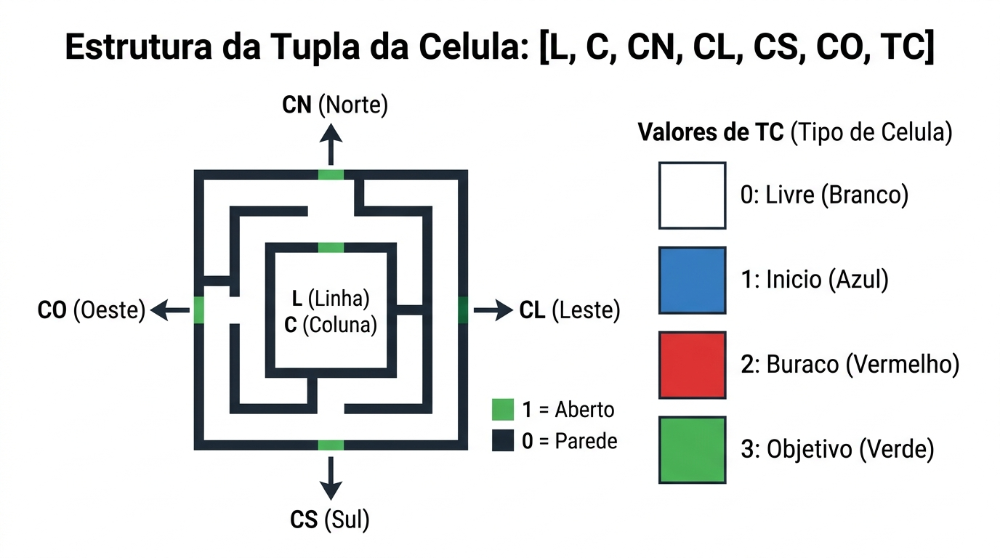
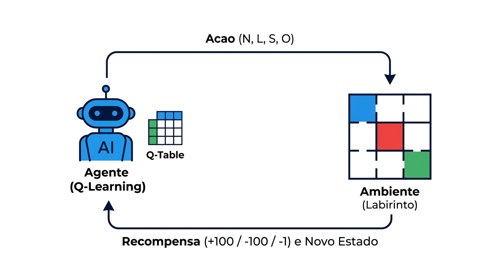
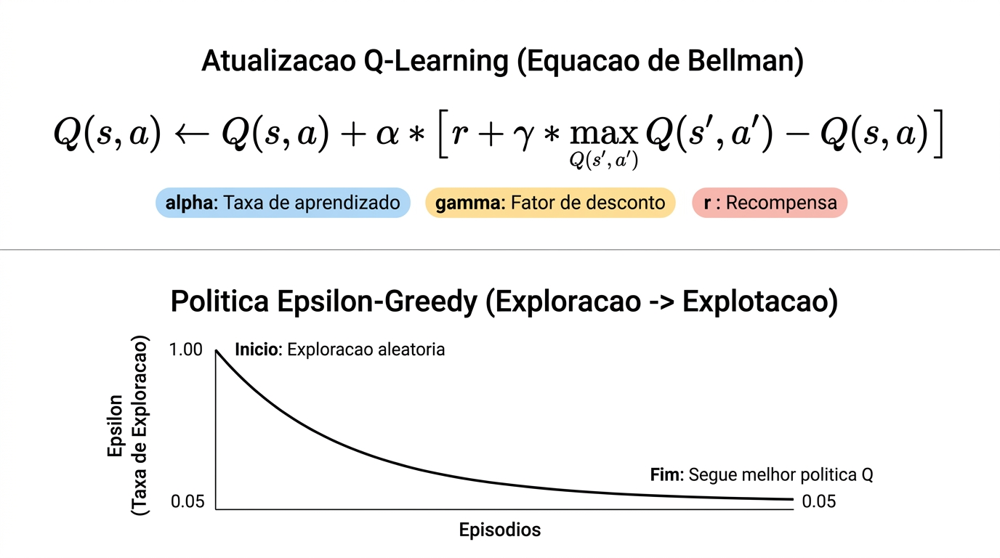
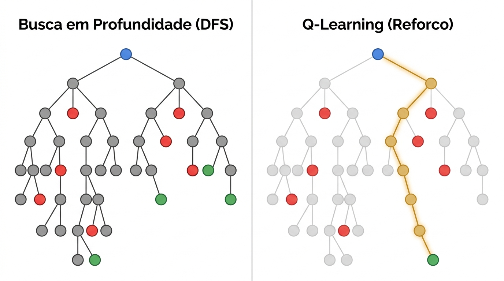
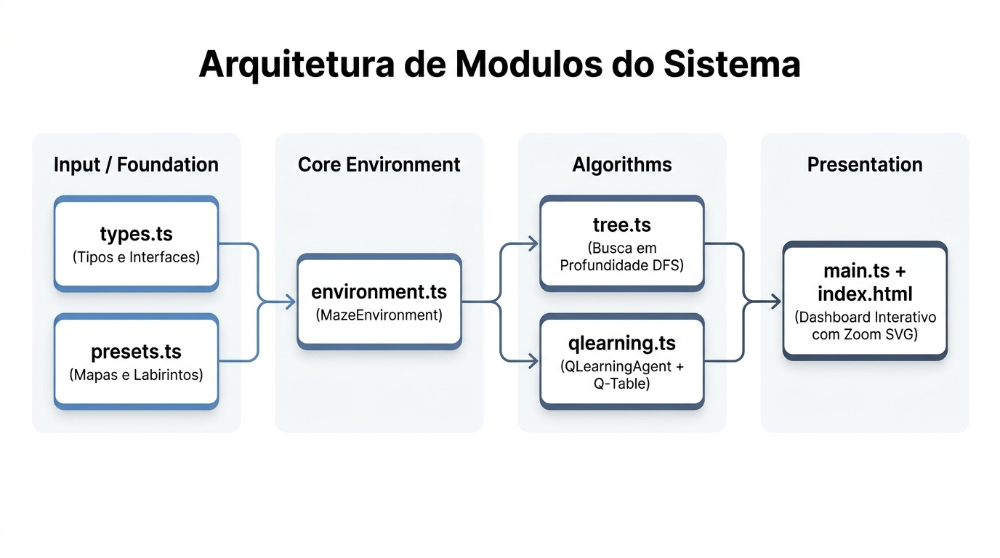
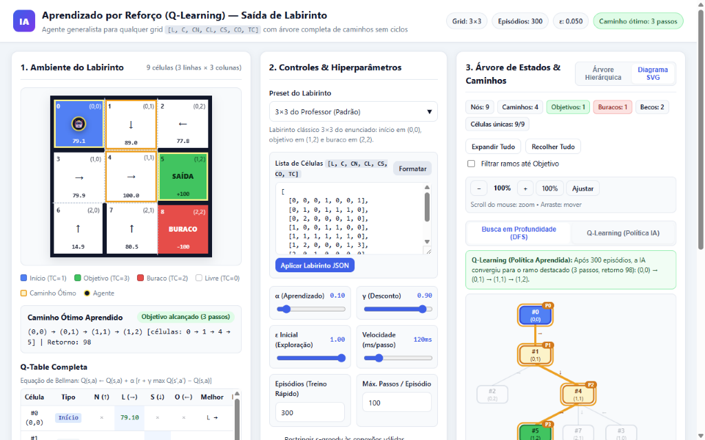

# Relatório Técnico — Aprendizado Baseado em Reforço para Saída de Labirinto (Q-Learning)

**Disciplina:** Inteligência Artificial  
**Professor:** Andre Borin Soares  
**Tecnologias:** TypeScript, Vite, HTML5, CSS3, SVG  
**Projeto:** `generic code/typescript/projetos/qlearning-labirinto`

---

## 1. Objetivo da Atividade

Implementar um algoritmo de **Aprendizado Baseado em Reforço (Reinforcement Learning)** capaz de aprender, por tentativa e erro, o caminho ótimo da posição inicial até a posição final (saída) de um labirinto qualquer, desviando de obstáculos/buracos e respeitando as paredes entre células.

Além do agente inteligente baseado em **Q-Learning**, a atividade exige a construção da **representação em árvore** partindo da célula inicial e contemplando todas as células e caminhos possíveis sem ciclos no mesmo ramo.

---

## 2. Modelagem do Ambiente e Representação das Células

O ambiente é fornecido por uma lista de tuplas de 7 inteiros no formato:

```text
[L, C, CN, CL, CS, CO, TC]
```

| Campo | Descrição | Valores possíveis |
| :--- | :--- | :--- |
| **`L`** | Índice da linha (Norte → Sul) | Inteiro $\ge 0$ |
| **`C`** | Índice da coluna (Oeste → Leste) | Inteiro $\ge 0$ |
| **`CN`** | Conectividade ao **Norte** (`L - 1, C`) | `1` (aberto) ou `0` (parede) |
| **`CL`** | Conectividade ao **Leste** (`L, C + 1`) | `1` (aberto) ou `0` (parede) |
| **`CS`** | Conectividade ao **Sul** (`L + 1, C`) | `1` (aberto) ou `0` (parede) |
| **`CO`** | Conectividade ao **Oeste** (`L, C - 1`) | `1` (aberto) ou `0` (parede) |
| **`TC`** | Tipo da célula | `0` Livre · `1` Início · `2` Buraco · `3` Objetivo |



### Generalização de Dimensões e Validação
A classe `MazeEnvironment` (`src/environment.ts`) não depende de um tamanho fixo `3×3`: ela calcula `rows` e `cols` dinamicamente a partir dos maiores índices `L` e `C` da entrada, aceitando grids quadrados ou retangulares (como `4×6` e `6×6`), e valida automaticamente a simetria das paredes entre células vizinhas.

> **Observação sobre o exemplo do enunciado (`3×3`):**  
> Na última linha do exemplo impresso no PDF original, consta `[2,2, 0,0,1, 2]` (6 elementos, omitindo um `0`). Considerando a conectividade a Oeste com a célula `[2,1]`, o registro completo foi padronizado como `[2, 2, 0, 0, 0, 1, 2]`.

---

## 3. Fundamentação Teórica: Q-Learning

No algoritmo **Q-Learning**, o agente não recebe o mapa pronto da saída: ele interage com o ambiente em episódios sucessivos, observando o estado atual $s = (L, C)$, escolhendo uma ação $a \in \{N, L, S, O\}$ e recebendo uma recompensa imediata $r$ e o próximo estado $s'$.



### 3.1. Função de Recompensa
| Evento no Ambiente (`MazeEnvironment.step`) | Recompensa ($r$) | Encerra Episódio? | Objetivo do Sinal |
| :--- | :---: | :---: | :--- |
| Atingir célula **Objetivo** (`TC = 3`) | `+100` | Sim | Recompensar fortemente a chegada à saída |
| Cair em **Buraco / Evitar** (`TC = 2`) | `-100` | Sim | Penalizar severamente armadilhas |
| Mover para célula **Livre / Início** (`TC = 0` ou `1`) | `-1` | Não | Incentivar o **caminho mais curto** possível |
| Tentar atravessar **Parede** (`conectividade = 0`) | `-10` | Não | Desencorajar ações inválidas |

### 3.2. Equação de Bellman e Política $\varepsilon$-Greedy
A cada transição $(s, a, r, s')$, a tabela `Q-Table` é atualizada pela regra temporal-difference (Equação de Bellman):

$$Q(s, a) \leftarrow Q(s, a) + \alpha \left[ r + \gamma \max_{a'} Q(s', a') - Q(s, a) \right]$$

Onde:
- **$\alpha$ (`alpha`, padrão `0.10`)**: taxa de aprendizado — define o peso das novas experiências sobre o valor antigo.
- **$\gamma$ (`gamma`, padrão `0.90`)**: fator de desconto — faz recompensas futuras próximas valerem mais que caminhos longos.
- **$\varepsilon$ (`epsilon`, de `1.00` até `0.05`)**: controla o equilíbrio entre **exploração** (testar caminhos aleatórios) e **explotação** (seguir o maior valor de $Q$).



---

## 4. Árvore de Estados (DFS) vs. Política Aprendida (Q-Learning)

Um ponto conceitual importante do sistema é a separação entre **representação estrutural do labirinto** e **aprendizado da IA**:

1. **Busca em Profundidade (DFS — `src/tree.ts`):**
   - Executada assim que o labirinto é carregado (`buildPathTree(env)`), **sem consultar a Q-Table**.
   - Percorre todas as conexões abertas a partir da célula inicial (`TC = 1`), mantendo um conjunto `visitedInCurrentPath` por ramo para evitar loops infinitos e encerrando ramos ao atingir `TC = 2` (buraco) ou `TC = 3` (objetivo).
   - Por isso, a árvore completa de possibilidades existe **mesmo com a Q-Table zerada**.

2. **Política Aprendida (Q-Learning — `src/qlearning.ts`):**
   - Começa com todos os valores $Q(s, a) = 0$ (sem conhecimento prévio da solução).
   - Somente após rodar episódios de treinamento é que `getBestPath()` segue $\arg\max_a Q(s, a)$ a partir da origem e destaca o ramo vencedor dentro da árvore (tanto na **Árvore Hierárquica** quanto no **Diagrama SVG**).



### Caminhos Diferentes Entre Execuções (Empates Ótimos)
Quando um labirinto possui **dois ou mais caminhos com o mesmo custo ótimo**, execuções independentes (após clicar em **Resetar Q-Table** e treinar novamente) podem convergir para rotas diferentes. Isso ocorre porque:
- A fase de exploração ($\varepsilon$-greedy) usa `Math.random()`, visitando os ramos em ordens distintas a cada treino;
- Em caso de empate numérico ($\Delta Q \le 10^{-12}$), o método `getBestAction()` realiza desempate aleatório entre as melhores ações.

---

## 5. Arquitetura da Aplicação

O projeto foi estruturado de forma modular em **TypeScript estrito** com interface web em **Vite**:



| Arquivo | Responsabilidade |
| :--- | :--- |
| `src/types.ts` | Tipos e interfaces (`Direction`, `CellType`, `RawCellTuple`, `Cell`, `TreeNode`, `BestPathResult`). |
| `src/presets.ts` | 8 modelos prontos (`3×3`, `4×4`, `4×6`, `5×5` e `6×6`) no formato `[L, C, CN, CL, CS, CO, TC]`. |
| `src/environment.ts` | Classe `MazeEnvironment`: parsing dinâmico, validação de paredes e transições/recompensas. |
| `src/tree.ts` | Função `buildPathTree` (DFS sem ciclos por ramo) e estatísticas (`getTreeStats`). |
| `src/qlearning.ts` | Classe `QLearningAgent`: `Q-Table`, política $\varepsilon$-greedy, Bellman, treino em lote/passo a passo. |
| `src/main.ts` | Dashboard interativo, gráficos SVG, sub-abas **DFS** vs. **Q-Learning** e sistema de **Zoom/Pan** com scroll do mouse. |
| `index.html` / `src/style.css` | Layout responsivo em 3 painéis (Ambiente/Q-Table, Controles/Métricas e Árvore de Estados). |

---

## 6. Resultados Experimentais

### 6.1. Validação no Labirinto Padrão `3×3` do Enunciado
Na execução com **300 episódios** (`α = 0.10`, `γ = 0.90`, `ε`: `1.00 → 0.05`), o agente aprendeu o caminho mínimo de **3 passos** evitando o buraco `(2,2)`:

`Caminho ótimo: (0,0) → (0,1) → (1,1) → (1,2) [células 0 → 1 → 4 → 5] | Retorno: 98`



*Na captura acima, observa-se à esquerda o grid `3×3` com as setas da política e os valores máximos de $Q(s,a)$, ao centro os hiperparâmetros e editor JSON, e à direita o Diagrama SVG na sub-aba **Q-Learning (Política IA)** destacando exatamente o ramo `P0 → P1 → P2 → P3` aprendido sobre a árvore.*

### 6.2. Comparativo Quantitativo nos 8 Modelos Implementados
Todos os presets abaixo foram validados com **0 inconsistências de parede** e treinados por **300 episódios** (`maxSteps = max(100, rows * cols * 4)`):

| Preset | Grid | Células | Nós (DFS) | Caminhos (DFS) | Rotas até Objetivo | Vitórias (300 ep.) | Melhor Caminho (Passos) | Retorno | Rotas Distintas (15 treinos) |
| :--- | :---: | :---: | :---: | :---: | :---: | :---: | :---: | :---: | :---: |
| `3×3 do Professor` | `3×3` | 9 | 9 | 4 | 1 | 290 | 3 | 98 | 1 |
| `4×4 Origem Inferior & Armadilhas` | `4×4` | 16 | 19 | 8 | 2 | 248 | 6 | 95 | 2 |
| `4×4 Simétrico (4 Rotas)` | `4×4` | 16 | 31 | 14 | 4 | 248 | 6 | 95 | 4 |
| `4×6 Retangular` | `4×6` | 24 | 199 | 86 | 18 | 204 | 8 | 93 | 4 |
| `5×5 Customizado` | `5×5` | 25 | 61 | 17 | 6 | 245 | 8 | 93 | 2 |
| `5×5 Dois Objetivos` | `5×5` | 25 | 36 | 16 | 3 | 240 | 5 | 96 | 1 |
| `5×5 Rota Norte vs. Sul` | `5×5` | 25 | 71 | 30 | 8 | 239 | 8 | 93 | 7 |
| `6×6 Labirinto Clássico` | `6×6` | 36 | 102 | 38 | 6 | 162 | 12 | 89 | 2 |

Destaques observados nos experimentos:
- **`5×5 Dois Objetivos`**: entre a saída próxima `(0,3)` (5 passos) e a saída distante `(4,4)` (8 passos), o agente convergiu consistentemente para a saída mais próxima (`retorno 96` vs. `93`) devido ao custo por passo (`-1`) e ao desconto $\gamma = 0.9$.
- **`4×4 Simétrico` e `5×5 Rota Norte vs. Sul`**: demonstram claramente a natureza estocástica da exploração em ambientes com múltiplos ótimos empatados — ao longo de 15 execuções independentes, o Q-Learning descobriu **4** e **7** trajetórias válidas distintas, respectivamente.
- **`4×6 Retangular`**: comprova a adaptação automática do parser e da `Q-Table` para matrizes não quadradas.

---

## 7. Como Executar Localmente

Na pasta `generic code/typescript/projetos/qlearning-labirinto`:

```powershell
# Instalar dependências (primeira vez)
npm.cmd install

# Iniciar servidor de desenvolvimento (Vite)
npm.cmd run dev

# Checar tipagem estrita TypeScript e gerar build de produção
npm.cmd run build
```

---

## 8. Conclusão

A solução atende integralmente aos requisitos propostos, combinando um ambiente genérico no padrão `[L, C, CN, CL, CS, CO, TC]` com o algoritmo **Q-Learning** e a **árvore completa de caminhos (DFS)**. A separação visual entre as abas **Busca em Profundidade (DFS)** e **Q-Learning (Política IA)** — somada ao recurso de **Zoom/Pan** no diagrama SVG — torna evidente a diferença entre o espaço geométrico de possibilidades do labirinto e o conhecimento adquirido pela IA ao longo dos episódios de reforço.
